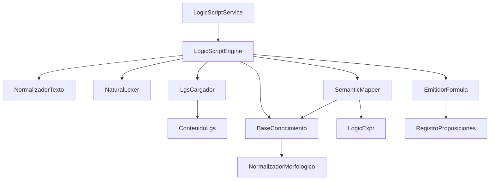

# Inventario de clases Java — LogicScript

Rutas relativas a `TautoTeacher2.0/src/main/java/`.  
**Negrita** = núcleo para migración. *Cursiva* = no migrar / legacy.

---

## Pipeline (orden de ejecución)

```text
LogicScriptService
    └── LogicScriptEngine
            ├── NormalizadorTexto
            ├── NaturalLexer
            ├── LgsCargador → ContenidoLgs
            ├── BaseConocimiento (+ NormalizadorMorfologico)
            ├── SemanticMapper
            ├── LogicExpr (IR)
            └── EmitidorFormula (+ RegistroProposiciones)
```

---

## Paquete `tautoteacher2.logicscript`

| Clase | Archivo | Responsabilidad | Migrar |
|-------|---------|-----------------|--------|
| **LogicScriptService** | `logicscript/LogicScriptService.java` | Fachada: `traducir(String)` | Sí |
| **LogicScriptEngine** | `logicscript/LogicScriptEngine.java` | Orquesta pipeline; segmentación por coma+si | Sí |
| **LogicScriptResult** | `logicscript/LogicScriptResult.java` | DTO éxito/error, fórmula, pasos, proposiciones | Sí |
| **RegistroProposiciones** | `logicscript/RegistroProposiciones.java` | Asigna p, q, r… por orden de aparición | Sí |
| **LogicScriptCli** | `logicscript/LogicScriptCli.java` | Demo consola (hoy usa MotorLogico) | Sí* |
| **LogicScriptRegressionHarness** | `logicscript/LogicScriptRegressionHarness.java` | ~40 casos regresión + tests .lgs | Sí |

\* Desacoplar de `MotorLogico` en proyecto independiente.

---

## Paquete `tautoteacher2.logicscript.ir`

| Clase | Responsabilidad | Migrar |
|-------|-----------------|--------|
| **LogicExpr** | Interfaz sellada (permits Atom, Neg, And, Or, Imp) | Sí |
| **AtomExpr** | Proposición atómica + bandera negada | Sí |
| **NegExpr** | Negación sobre subexpresión | Sí |
| **AndExpr** | Conjunción binaria | Sí |
| **OrExpr** | Disyunción binaria | Sí |
| **ImpExpr** | Implicación (antecedente, consecuente) | Sí |
| **EquivExpr** | Equivalencia / bicondicional | Sí |
| **EmitidorFormula** | Recorre IR → cadena con ¬ ∧ ∨ → ↔ | Sí |

---

## Paquete `tautoteacher2.nlp.normalizacion`

| Clase | Responsabilidad | Migrar |
|-------|-----------------|--------|
| **NormalizadorTexto** | Minúsculas, NFD sin diacríticos, espacios, `;`→`,` | Sí |

---

## Paquete `tautoteacher2.nlp.lexer`

| Clase | Responsabilidad | Migrar |
|-------|-----------------|--------|
| **NaturalLexer** | Tokeniza conectores + literales | Sí |
| **TokenNatural** | Par (TipoTokenNatural, lexema) | Sí |
| **TipoTokenNatural** | Enum: SI, ENTONCES, Y, O, LITERAL, CUANDO, … | Sí |
| *LexerNatural* | Stub legacy | No |
| *Token*, *TipoToken* | Legacy | No |

---

## Paquete `tautoteacher2.nlp.lexicon`

| Clase | Responsabilidad | Migrar |
|-------|-----------------|--------|
| **LgsCargador** | Parser línea a línea de `.lgs` | Sí |
| **ContenidoLgs** | DTO: lemas + patrones + morfología | Sí |
| **BaseConocimiento** | `canonicalizarFragmento`, integra lemma+lexrule | Sí |
| **NormalizadorMorfologico** | Aplica reglas morfológicas | Sí |
| **ReglaMorfologicaLgs** | Modelo de una `lexrule` | Sí |
| **ConfiguracionMorfologiaLgs** | Lista reglas + exclusiones | Sí |
| **PatronSemanticoLgs** | Record: nombre, forma, tipo IR, índices | Sí |
| **TipoSalidaIrPatron** | Enum: IMP, AND, OR, IMP_AND, IMP_OR, … | Sí |
| **ResultadoCargaLgs** | Diagnóstico de carga con estado | Sí |
| **EstadoCargaLgs** | OK, ERROR_SINTAXIS, RECURSO_NO_ENCONTRADO | Sí |
| *Lexico*, *ReglasPatron*, *DiccionarioSinonimos* | Stubs / legacy | No |

---

## Paquete `tautoteacher2.nlp.semantica`

| Clase | Responsabilidad | Migrar |
|-------|-----------------|--------|
| **SemanticMapper** | Coincidencia de patrones → IR; fallbacks | Sí |
| *MapeadorSemantico* | Stub vacío | No |
| *RegistroProposiciones* (duplicado) | Stub en semantica | No |

---

## Paquete `tautoteacher2.nlp.parser` — NO MIGRAR

| Clase | Estado |
|-------|--------|
| *ParserNatural*, *NodoNL*, *TipoNodoNL* | Vacíos; pipeline real no los usa |

---

## Consumidores en TautoTeacher (permanecen en app)

| Clase | Paquete | Uso |
|-------|---------|-----|
| TautoTeacherApp | `ui` | Llama `LogicScriptService.traducir` |
| MotorLogico | `core.logica` | Evalúa fórmula emitida |
| ExplicacionEducativaBuilder | `core.logica` | Texto pedagógico |
| ConstructorArbolEvaluacion | `core.visualizacion` | Árbol de evaluación |

---

## Recursos

| Recurso | Ruta | Migrar |
|---------|------|--------|
| **core.lgs** | `src/main/resources/logicscript/core.lgs` | Sí |

---

## Resumen numérico

| Categoría | Archivos |
|-----------|----------|
| Núcleo LogicScript + IR | 14 |
| NLP (lexer, lexicon, semantica, normalizacion) | 16 |
| **Total a migrar** | **~30** |
| Stubs / legacy NLP | ~10 (excluir) |
| UI + MotorLogico | permanece en TautoTeacher |

---

## Dependencias entre paquetes (grafo)



---

Ver también: `documentacion-original/LogicScript/MapaImplementacionJava.md` (citas de código).
